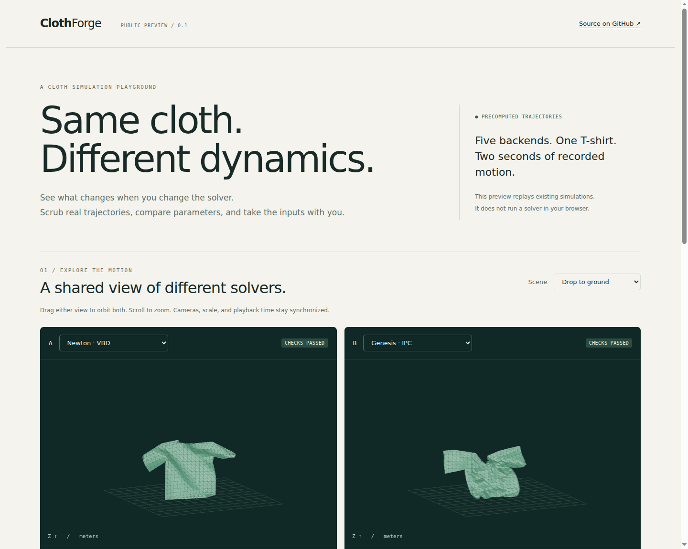
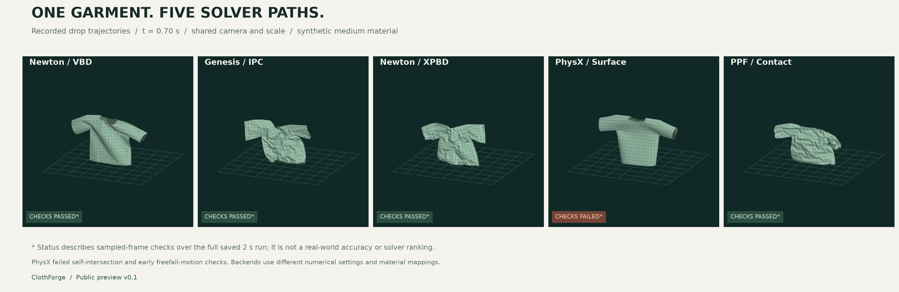

<div align="center">

# ClothForge

### A visual playground for cloth simulation across engines and solvers
### 跨引擎、跨求解器的布料仿真可视化工作台

**Compare motion. Inspect parameters. Reproduce the setup.**<br>
**对比运动效果 · 查看实际参数 · 复现仿真配置**

[](LICENSE)
[](pyproject.toml)
[](#preview)

[Overview / 项目概览](#overview) · [Quick start / 快速开始](#quick-start) · [Backends / 求解后端](#backends) · [Reproduce / 本地复现](#reproduce) · [Roadmap / 路线图](#roadmap)

</div>

<a id="overview"></a>
## Overview · 项目概览

ClothForge brings parametric garment geometry, solver adapters, physical checks, and trajectory visualization into an inspectable workflow. It helps developers and researchers explore how cloth behaves under different solver paths and numerical settings, with the actual inputs and results available to download.

ClothForge 将参数化衣物几何、求解器适配、物理检查和轨迹可视化串成可追溯的工作流，帮助开发者与研究者观察不同求解路径和数值设置下的布料行为，并下载实际使用的输入与结果。



*Actual browser screenshot: shared camera and timeline, solver selection, and visible validation status.*<br>
*真实网页截图：共享相机与时间轴，支持求解器选择，并显示物理检查状态。*

<a id="preview"></a>
### Public preview v0.1 · 当前公开版本

The standalone website includes **five solver backends × two scenes = 10 recorded simulations** of one synthetic T-shirt. It needs no GPU, application server, or external JavaScript library. Selecting a backend loads an existing trajectory; editable parameters and on-demand simulation are planned for the local workbench.

独立网页包含同一件合成 T 恤在 **5 个求解后端 × 2 个场景下的 10 条已保存仿真轨迹**，无需 GPU、应用服务器或外部 JavaScript 库。选择后端会加载已有轨迹；自由编辑参数与按需重算计划在本地工作台中提供。

| Capability · 功能 | Included in v0.1 · 当前支持 |
|---|---|
| **Synchronized comparison · 同步对比** | Compare any two backends with a shared camera, scale, and simulation time.<br>任意两个后端并排显示，共享相机、比例和仿真时间。 |
| **Trajectory exploration · 轨迹交互** | Play, pause, seek, orbit, and zoom saved cloth meshes.<br>播放、暂停、拖动时间轴、旋转与缩放布料网格。 |
| **Parameter inspection · 参数查看** | Inspect material values, numerical settings, metrics, and failed gates.<br>查看材料参数、数值设置、物理指标与失败原因。 |
| **Artifact downloads · 产物下载** | Original NPZ trajectories, source mesh, configuration snapshots, and provenance.<br>下载原始 NPZ 轨迹、源网格、配置快照与来源记录。 |
| **Python pipeline · Python 工具链** | Garment generation, backend adapters, diagnostics, and physical checks.<br>提供衣物生成、后端适配、诊断与物理检查源码。 |

### One garment, five solver paths · 同一件衣物，五种求解路径



*Drop scene at **t = 0.70 s**, rendered from the original saved trajectories. Material values are nominally shared; backend mappings and numerical settings differ. Badges describe checks over the full saved two-second run. The failed PhysX case remains visible.*<br>
*从原始保存轨迹绘制的落地场景 **t = 0.70 s** 快照。名义材料参数相同，各后端的映射与数值设置不同。标记对应完整两秒保存轨迹的检查结果，并保留 PhysX 失败案例。*

Inspect the [case catalog](docs/assets/catalog.json) for source run IDs, settings, metrics, and trajectory hashes.<br>
可在[案例索引](docs/assets/catalog.json)中查看来源运行 ID、实际设置、指标与轨迹哈希。

<a id="quick-start"></a>
## Quick start · 快速开始

Run the comparison website with Python's built-in static server. No package installation is required for this path.<br>
使用 Python 自带的静态服务器打开对比网页；这条路径无需安装项目依赖。

```bash
git clone https://github.com/codeofwhite/ClothForge.git
cd ClothForge
python3 -m http.server 8080 --bind 127.0.0.1 --directory docs
```

Open **<http://127.0.0.1:8080>**. Choose a scene and two backends, then play or scrub the timeline. Drag either viewport to rotate both views; scroll to zoom.<br>
打开 **<http://127.0.0.1:8080>**，选择场景与两个后端，即可播放或拖动时间轴。拖动画面可同时旋转两个视图，滚轮可缩放。

Serve `docs/` over HTTP rather than opening `index.html` directly, because the viewer fetches JSON assets. For a remote machine, forward the chosen port to your local computer.<br>
网页通过 HTTP 读取 JSON 资源，因此请启动静态服务器，而非直接双击 `index.html`。若在远程机器运行，请将所选端口转发到本机。

<details>
<summary><b>Publish with GitHub Pages · 发布为 GitHub Pages 网页</b></summary>

Choose **Settings → Pages → Deploy from a branch → main → /docs**, then save and wait for GitHub's deployment to complete. The website source is included in this repository; hosting availability depends on the repository's Pages configuration and deployment status.

在仓库中选择 **Settings → Pages → Deploy from a branch → main → /docs**，保存后等待 GitHub 部署完成。仓库已包含网页源码；能否公开访问取决于 Pages 配置与部署状态。

</details>

<a id="backends"></a>
## Solver backends · 求解后端

ClothForge distinguishes the engine from the solver and any contact extensions. The table describes the **selected historical preview cases**, not universal solver performance or a fresh runtime validation.<br>
ClothForge 区分引擎、求解器及接触扩展。下表描述的是**当前选入的历史预览案例**，不代表求解器的一般性能，也不是新一轮运行时验证。

| Backend ID | Engine / solver · 引擎与求解路径 | Preview notes · 预览说明 |
|---|---|---|
| `newton_vbd` | Newton / VBD | Hanging and drop cases passed sampled-frame checks.<br>悬挂与落地案例通过了采样帧检查。 |
| `genesis_ipc` | Genesis + libuipc / IPC FEM | Both cases passed; material mapping is not calibrated equivalence.<br>两个案例通过检查；材料映射不代表经过标定的等效性。 |
| `newton_xpbd` | Newton / XPBD + ClothForge contact extensions | Both cases passed; discrete projections are not certified CCD.<br>两个案例通过检查；离散接触投影不构成经认证的连续碰撞检测。 |
| `physx_surface` | Isaac Sim / PhysX Surface Deformable | Both selected cases failed historical checks; results and reasons are preserved.<br>所选两个案例未通过历史检查，结果与原因均保留。 |
| `ppf` | PPF contact solver / isolated Docker runtime | Both cases passed; offline runtime requires a separately obtained compatible image.<br>两个案例通过检查；离线路径需另行获取兼容镜像。 |

Backend-specific environments, historical versions, material mappings, and output contracts are documented in [Backend notes](docs/BACKENDS.md).<br>
各后端的独立环境、历史版本、材料映射与输出契约见[后端说明](docs/BACKENDS.md)。

<a id="reproduce"></a>
## Run locally · 本地复现

### 1. Install the common package · 安装公共工具包

Use Python **3.11+**. The common package provides analysis and preview utilities; install the chosen solver in its own compatible environment.<br>
使用 Python **3.11+**。公共工具包提供分析与预览工具；需要重算时，请在独立兼容环境中安装所选求解器。

```bash
python3 -m venv .venv
.venv/bin/python -m pip install -e '.[preview]'
.venv/bin/python -m clothforge --help
```

This command does not install the GPU solvers, GarmentCode, or CGAL. Release checks reused existing environments; clean-machine installation remains unverified.<br>
这条命令不会安装 GPU 求解器、GarmentCode 或 CGAL。发布验证复用了已有环境，尚未验证全新机器安装流程。

### 2. Reuse an included garment · 使用随附衣物输入

Each recorded case includes its resolved material, numerical settings, and quality gates in `config-medium.json`. Copy the selected case's configuration beside the shared mesh and manifest.<br>
每个案例的 `config-medium.json` 包含实际使用的材料、数值设置和质量门槛。将所选案例的配置复制到共享网格与清单旁即可准备输入。

```bash
mkdir -p outputs/tshirt-input
cp docs/assets/garment/mesh.npz docs/assets/garment/manifest.json outputs/tshirt-input/
cp docs/assets/cases/newton_vbd-drop/config-medium.json outputs/tshirt-input/
```

Run in a compatible **Newton environment** with this source available. Replace the interpreter path and select an available GPU before launching.<br>
在能够加载本项目源码的兼容 **Newton 环境**中运行。启动前替换解释器路径，并选择可用 GPU。

```bash
CUDA_VISIBLE_DEVICES=0 PYTHONPATH=src \
  /path/to/newton-env/bin/python -B -m clothforge simulate \
  --garment outputs/tshirt-input --material medium --scenario drop \
  --engine newton_vbd --output outputs/my-vbd-drop
```

Use a new output directory. For another backend, copy **that case's** configuration and choose its `--engine`; settings cannot be assumed interchangeable. PhysX requires `CLOTHFORGE_ISAAC_PYTHON`; PPF requires a compatible runtime image obtained separately. Historical hashes identify old artifacts and do not promise bitwise reproduction with the newer public source.

输出目录必须是新目录。更换后端时，应复制**对应案例**的配置并选择相应的 `--engine`，不能默认设置可以互换。PhysX 需设置 `CLOTHFORGE_ISAAC_PYTHON`；PPF 需另行获取兼容运行镜像。历史哈希用于识别原始产物，不保证当前公开源码能够逐字节复现旧结果。

### 3. Generate new garments · 生成新衣物

The generator supports T-shirts, trousers, coats, and additional textile/garment variants. Generation requires GarmentCode, its dependencies, and CGAL Python bindings. The original generation environment used NumPy 1.26.4; consult the upstream instructions for the pinned revision.<br>
生成器支持 T 恤、长裤、外套及其他布片与衣物变体，依赖 GarmentCode、其依赖包与 CGAL Python 绑定。原始生成环境使用 NumPy 1.26.4；安装时请参考固定版本对应的上游说明。

```bash
mkdir -p third_party
git clone https://github.com/maria-korosteleva/GarmentCode.git third_party/GarmentCode
git -C third_party/GarmentCode checkout d449629979028123a5c4dc9e732a2ec19b7fce31

# After setting up the generator environment / 配置好生成环境后执行
PYTHONPATH=src:third_party/GarmentCode \
  /path/to/generation-env/bin/python -B -m clothforge generate \
  --config configs/pilot_v1.json --output outputs/generated --limit 1
```

`--limit 1` generates at most one garment per category. Geometry generation does not certify dynamics. Public starter numerical settings are adapted from a recorded VBD recipe and have not been validated for every new garment. The browser preview currently includes only one T-shirt.<br>
`--limit 1` 表示每类最多生成一件衣物。生成几何不等于通过动力学验证。公开版初始数值设置取自已有 VBD 配方，尚未对所有新衣物验证；网页当前仅包含一件 T 恤。

## Workflow & repository · 工作流与目录

```text
Garment geometry + material + scene + numerical settings
衣物几何 + 材料 + 场景 + 数值设置
                         │
                         ▼
                  Backend adapter
                    后端适配器
                         │
                         ▼
          Trajectory + initialization + diagnostics
                  轨迹 + 初始化记录 + 诊断
                         │
                         ▼
            Physical checks + replay + downloads
                  物理检查 + 回放 + 下载
```

| Path · 路径 | Role · 职责 |
|---|---|
| [`src/clothforge/`](src/clothforge/) | Geometry, material mapping, workers, diagnostics, and exporters.<br>几何、材料映射、求解器 worker、诊断与导出。 |
| [`configs/`](configs/) | Garment presets and controlled numerical-repair recipes.<br>衣物预设与受控数值修复配方。 |
| [`tests/`](tests/) | Physical-invariant and adapter contract checks.<br>物理不变量与适配器契约检查。 |
| [`docs/`](docs/) | Build-free browser viewer and technical documentation.<br>无需构建的网页查看器与技术文档。 |
| [`docs/assets/cases/`](docs/assets/cases/) | Recorded trajectories, validation, and parameter snapshots.<br>已保存轨迹、验证结果与参数快照。 |
| [`docs/assets/garment/`](docs/assets/garment/) | Shared source mesh and garment manifest.<br>共享源网格与衣物清单。 |

The standalone viewer is independent of Robot Data Studio. The original development integration, its database, robot control services, and job scheduler are outside this public package.<br>
独立查看器无需 Robot Data Studio。原始开发集成中的数据库、机器人控制服务与作业调度器不包含在当前公开包中。

## Validation & scope · 验证与适用范围

The release includes **23 passing CPU tests**, browser interaction checks, and artifact-hash verification. These are packaging and contract checks; the GPU simulations were not rerun for the public release. Detailed evidence is recorded in the [release report](docs/RELEASE.md).<br>
首版发布完成了 **23 项 CPU 测试**、浏览器交互检查与产物哈希核对。这些验证针对打包与代码契约；公开发布时未重跑 GPU 仿真。详细证据见[发布记录](docs/RELEASE.md)。

| Interpretation · 如何理解结果 | Scope · 范围 |
|---|---|
| **Material · 材料** | `synthetic_unmeasured`: synthetic presets without real-material calibration.<br>合成预设，尚未进行真实材料标定。 |
| **Physical checks · 物理检查** | Historical checks cover 61 saved frames over two seconds: stretch, area, self-intersection, ground penetration, finite state, and configured motion checks.<br>历史检查覆盖两秒内的 61 个保存帧，包括拉伸、面积、自穿插、地面穿透、有限状态及所配置的运动检查。 |
| **Cross-backend comparison · 跨后端比较** | Shared nominal values do not guarantee equivalent constitutive response, damping, or contact laws.<br>相同名义参数不保证本构响应、阻尼或接触规律等效。 |
| **Runtime · 耗时** | Historical solver times use different numerical settings and are not an equal-compute speed ranking.<br>历史求解耗时采用不同数值设置，不构成相同计算预算下的速度排名。 |
| **Evidence boundary · 证据边界** | Passing saved-frame checks does not establish continuous nonpenetration, long-horizon stability, real-cloth accuracy, manipulation success, or sim-to-real validity.<br>采样帧检查通过，不代表连续无穿透、长时域稳定、真实布料精度、操作成功或仿真到真实有效性。 |

Review status / 审阅状态：`SELF_REVIEWED_PROVISIONAL`.

For a representative CPU check in an existing compatible generation environment:<br>
在已有兼容生成环境中，可执行以下代表性 CPU 检查：

```bash
PYTHONPATH=src:third_party/GarmentCode PYTHONDONTWRITEBYTECODE=1 \
  /path/to/generation-env/bin/python -B -m unittest discover -s tests -p 'test_pipeline.py'
```

The XPBD contact suite needs its compatible Newton/Warp runtime and was not run in the CPU-only release environment. The PhysX mock suite requires the launcher environment variable even though subprocess execution is mocked; see the release report.<br>
XPBD 接触测试依赖兼容的 Newton/Warp 运行环境，未纳入首版 CPU 验证。PhysX 模拟测试虽然不启动真实子进程，仍需设置启动器环境变量；详见发布记录。

<a id="roadmap"></a>
## Roadmap · 路线图

- [x] Standalone public source and synchronized trajectory viewer.<br>
  独立公开源码与同步轨迹查看器。
- [x] Configuration downloads, provenance, and visible failed cases.<br>
  配置下载、来源追踪与失败案例展示。
- [ ] Parameter-sweep navigation across more materials and garments.<br>
  支持更多材料与衣物的参数扫描浏览。
- [ ] Local run service with editable parameters and on-demand simulation.<br>
  提供可编辑参数、支持按需重算的本地运行服务。
- [ ] Clean-environment setup validation for each backend.<br>
  验证各后端在全新环境中的安装与运行流程。
- [ ] Measured material calibration and controlled physical experiments.<br>
  开展实测材料标定与受控物理实验。

## Acknowledgments & license · 致谢与许可

ClothForge builds on the work of the garment-generation and physics-simulation communities. The parametric generation pipeline uses [GarmentCode](https://github.com/maria-korosteleva/GarmentCode); solver adapters connect to the upstream projects listed in [third-party notices](THIRD_PARTY_NOTICES.md).<br>
ClothForge 基于衣物生成与物理仿真社区的工作构建。参数化生成链路使用 [GarmentCode](https://github.com/maria-korosteleva/GarmentCode)，求解器适配所连接的上游项目列于[第三方说明](THIRD_PARTY_NOTICES.md)。

ClothForge code and the included synthetic demo artifacts are released under the **[MIT License](LICENSE)**. Third-party engines, containers, and datasets retain their own terms and are not bundled.<br>
ClothForge 源码与随附的合成演示产物采用 **[MIT 许可证](LICENSE)**。第三方引擎、容器和数据集遵循各自条款，未随本项目打包分发。
